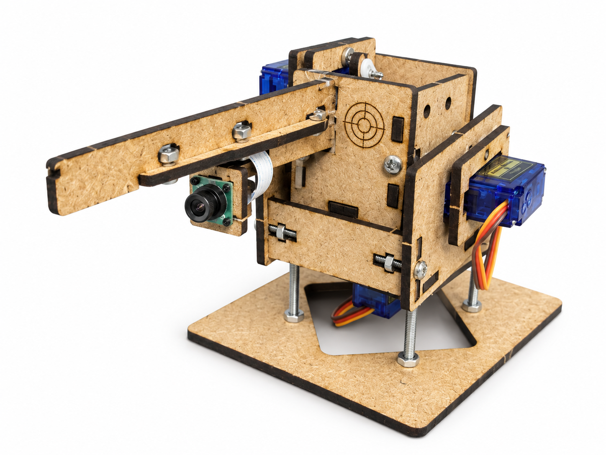
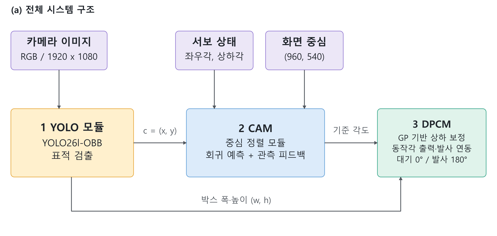
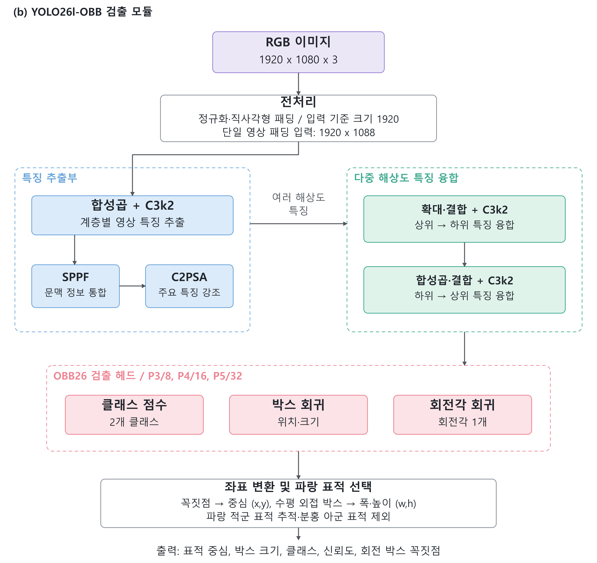
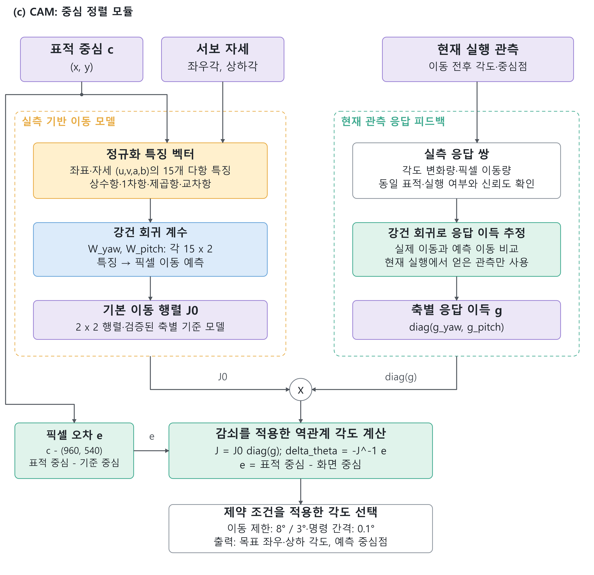
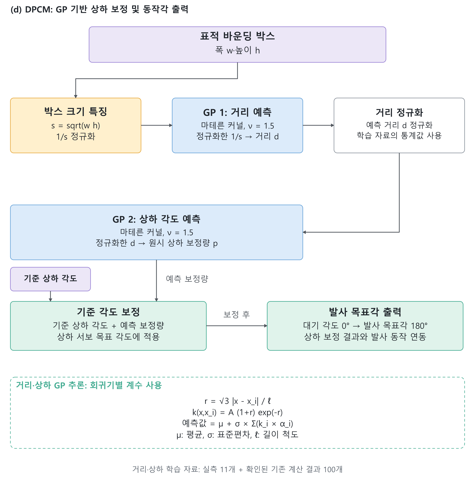

# 고무줄 총 자동화 시스템 개발 보고서

5조 강준모 정영서 조성호 허재원

본 과제는 카메라로 파랑 enemy 표적을 찾아 방향을 정렬하고, 거리별 상하 보정 후 고무줄을 발사하는 시스템을 개발하는 것이다. 이미지에서 서보 각도를 직접 예측하는 두 방식과, 검출·중심 정렬·상하 보정을 분리하는 방식을 비교했다. 최종 시스템은 **YOLO 검출 모델 + 중심 정렬 모듈(CAM, Center Alignment Module) + 거리 기반 상하 보정 모듈(DPCM, Distance-based Pitch Correction Module)**로 구성했다.

## 하드웨어 구성과 카메라 배치

본 시스템은 목재 프레임, 전방 막대, 좌우·상하 방향 조절 서보, 발사 서보, 라즈베리파이 카메라로 구성된다. 카메라는 막대 바로 아래에 장착해 같은 방향을 바라보도록 정렬했다.



그림 1. 실제 사진을 바탕으로 카메라 장착 상태를 재구성한 하드웨어 설명용 이미지

**구동부와 카메라:** 방향 조절 서보가 움직이면 막대 아래의 카메라도 함께 움직인다. 화면 중심이 바라보는 방향과 막대의 지향 방향을 맞춰, 영상 중심을 기구의 방향 정렬 기준으로 사용한다. 라즈베리파이가 촬영한 영상을 PC로 전송하면 YOLO와 보정 모듈이 서보 목표 각도를 계산한다.

## 1. Task 구현을 위해 논의했던 방법들

### 1.1. 방법 1 이미지에서 서보모터 각도를 직접 예측하는 Transformer 기반 E2E 모델

첫 번째 방법은 카메라 이미지 한 장을 입력받아 좌우·상하 서보모터의 목표 각도를 직접 출력하는 End-to-End 모델이다. 이미지를 패치 단위로 나누고 Transformer로 특징을 처리한 뒤, 회귀 출력층에서 모터 각도를 예측하도록 설계한다.

```text
카메라 이미지 → Transformer → 좌우·상하 서보 목표 각도 → 모터 이동
```

이 방식에서는 표적 검출, 중심점 오차 계산, 각도 보정을 명시적으로 나누지 않고 이미지와 정답 각도의 관계를 하나의 모델이 학습한다. 중심 맞춤뿐 아니라 마지막 상하 보정까지 포함한 최종 각도를 정답으로 구성하면 전체 동작을 하나의 예측 문제로 정의할 수 있다.

학습에는 이미지와 올바른 서보 각도의 쌍이 필요하다. 동일한 픽셀 위치라도 촬영 시작 자세에 따라 목표 절대각이 달라질 수 있으므로, 현재 서보 자세를 입력하거나 시작 자세를 일정하게 맞춰야 한다.

### 1.2. 방법 2 YOLO 검출과 마스킹 후 CNN으로 서보모터 각도를 예측하는 모델

두 번째 방법은 먼저 YOLO로 파란 표적의 바운딩 박스를 구하고, 표적 이외의 영역을 마스킹한 이미지를 CNN에 입력해 서보모터 각도를 예측하는 방식이다.

```text
카메라 이미지 → YOLO 바운딩 박스 검출 → 표적 외부 영역 마스킹
→ CNN 회귀 모델 → 좌우·상하 서보 목표 각도 → 모터 이동
```

마스킹은 YOLO의 검출 박스 밖을 가리는 전처리다. YOLO가 표적을 찾고, CNN은 배경을 제거한 이미지에서 필요한 서보 각도를 학습한다.

전처리에서는 표적의 원래 위치와 크기를 유지해야 한다. 검출 영역만 잘라 동일한 크기로 확대하면 중심 오차와 크기 정보가 사라질 수 있으므로, 원본 영상에서 배경을 가리는 방식으로 구성한다.

### 1.3. 방법 3 YOLO와 CAM 및 DPCM을 결합한 시스템

세 번째 방법은 표적의 위치를 찾는 문제, 화면 중심에 맞추는 문제, 마지막 상하 각도를 정하는 문제를 세 개의 기능 모델로 분리하는 방식이다.

중심 정렬을 담당하는 CAM은 **다항 특징을 사용하는 강건 회귀 모델과 관측 피드백 제어**로 구성된다. DPCM은 **GP 회귀를 이용한 거리·상하 보정량 예측과 서보 목표각 출력을 통합한 모듈**이다. CAM이 정한 기준 자세에 거리별 보정량을 반영하고, 상하 서보와 발사 서보의 목표 각도를 연결해 정렬부터 발사까지의 동작을 완성한다.

가우시안 프로세스(Gaussian Process, GP)는 여러 입력에서의 함수값들이 함께 가우시안 분포를 따른다고 가정해 입력과 출력의 관계를 확률적으로 표현하는 모델이다. 이를 회귀 문제에 적용한 가우시안 프로세스 회귀(Gaussian Process Regression, GPR)는 커널 함수로 입력 간 유사성을 나타내고, 학습 데이터에 조건을 둬 새로운 입력의 출력값을 예측한다. 본 시스템의 DPCM은 이 예측의 평균값을 이용해 박스 크기에서 거리를 구하고, 그 거리에서 추가 상하 보정량을 구한다.

## 2. 논의한 방법들 중 시도했던 방법들

논의한 세 방법을 모두 실제 장치에 적용해 비교했다. 방법 1은 전체 이미지에서, 방법 2는 YOLO 검출 후 마스킹한 이미지에서 서보 각도를 예측했다. 방법 3은 검출·중심 정렬·상하 보정을 분리해 연결했다. 실험 조건과 결과는 4절에 정리했다.

방법 3의 구현에서는 먼저 사진에서 얻은 실제 픽셀 이동과 서보 각도 변화의 관계로 CAM을 구성했다. 이후 이동 전후 관측에서 얻은 현재 실행의 피드백을 반영하도록 했으며, 마지막 거리·상하 보정에는 학습된 가우시안 프로세스 모델을 연결했다.

## 3. 시도했던 각 방법들을 선택한 이유

### 3.1. 방법 1을 시도한 이유

이미지에서 최종 모터 각도로 직접 연결하면 별도의 바운딩 박스 처리와 중심 오차 계산을 줄일 수 있다는 점에서 선택했다. Transformer가 전체 이미지의 표적 위치와 주변 정보를 함께 처리해 필요한 동작을 한 번에 예측할 수 있을 것으로 기대했다.

### 3.2. 방법 2를 시도한 이유

표적 검출을 YOLO에 맡기고 마스킹된 이미지를 CNN에 제공하면, 불필요한 배경을 줄이고 표적에 관련된 정보를 중심으로 각도 회귀를 학습할 수 있다는 점에서 선택했다. 검출 결과를 확인하며 표적 선택과 각도 예측을 단계별로 점검할 수 있다는 점도 고려했다.

### 3.3. 방법 3을 시도한 이유

첫째, 표적 인식과 각도 결정을 모듈별로 나누어 설계할 수 있다. YOLO는 표적의 위치와 크기를 검출하고, CAM은 중심 정렬에 필요한 각도를 계산하며, DPCM은 거리별 상하 보정과 발사 동작을 연결한다. 각 단계의 입력과 출력을 확인할 수 있어 문제의 원인을 분석하기 쉽다고 판단했다.

둘째, 학습 데이터 확보의 부담을 줄일 수 있다. 모든 이미지 상황에 대한 최종 정답 각도를 수집하는 대신, 표적 중심의 픽셀–각도 응답 관계와 거리별 상하 보정 관계를 나누어 학습할 수 있다. 이미 확보한 사진과 실측 자료를 활용하고, 비교적 작은 회귀 모델로 필요한 관계를 표현할 수 있을 것으로 기대했다.

셋째, 관측 피드백을 이용해 중심 정렬의 오차를 보완할 수 있다. 이동 전후의 표적 위치를 비교하면 예측한 이동과 실제 기구 응답의 차이를 확인할 수 있다. 이 정보를 다음 각도 계산에 반영해 중심 정렬을 더 안정적으로 수행할 수 있을 것으로 예상했다.

넷째, 중심 정렬과 거리별 상하 보정을 별도로 조정할 수 있다. CAM이 화면 중심을 기준으로 방향을 정렬하면, DPCM은 표적 크기로 추정한 거리에 맞춰 추가 상하 각도를 결정한다. 두 기능을 분리하면 한쪽을 개선할 때 다른 기능까지 함께 학습해야 하는 부담을 줄일 수 있어 본 과제에 적합하다고 판단했다.

## 4. 시도했던 각 방법들의 실험 결과

### 4.1. 실제 실험 구성과 평가 항목

장치로부터 1.5~2.0m 범위에 표적 두 개를 배치하고, 세 방법을 각각 15회씩 실제 장치에서 시도했다. 각 방법의 성공 횟수를 비교하고, 실패한 경우에는 고무줄과 표적 사이의 거리를 측정해 평균을 구했다. 성공률은 성공 횟수를 각 방법의 전체 시도 횟수인 15회로 나눠 계산했다.

실패 시 평균 거리는 실패한 시도만을 대상으로 계산했다. 성공 여부와 함께 실패했을 때 표적에 얼마나 가깝게 도달했는지를 평가했다.

### 4.2. 방법 1의 예상과 실제 결과

**예상:** Transformer가 이미지에서 최종 서보 각도를 직접 출력하면 처리 단계를 줄일 수 있지만, 최종 성공률은 방법 3보다 낮을 것으로 예상했다. 이 방식은 다양한 이미지 상황마다 올바른 서보 각도를 정답 데이터로 확보해야 한다. 같은 서보 각도를 사용해도 외부 요인에 따라 고무줄의 도달 거리와 위치가 달라질 수 있으므로, 표적 위치뿐 아니라 이러한 변화까지 포함한 각도 데이터를 수집해야 한다.

모든 표적 위치와 조건에 대한 정답 각도를 실측하는 데에는 한계가 있었다. 확보하지 못한 위치나 학습 데이터와 다른 조건에서는 모델이 예측한 각도에 오차가 발생할 것으로 예상했다.

**실제 결과:** 15회 중 4회 성공해 성공률은 약 26.7%였다. 실패한 경우 고무줄과 표적 사이 평균 거리는 약 11cm였다.

**예상 대비 평가:** 전체 이미지에서 각도를 직접 예측하는 구조를 적용했지만, 실험에서 성공 횟수가 가장 적었다. 이 결과는 다양한 위치와 외부 조건을 충분히 포함하지 못한 각도 학습 데이터의 한계로 오차가 발생할 것이라는 사전 예상과 부합했다. 다만 집계 결과만으로 개별 실패 원인을 모두 특정한 것은 아니다.

### 4.3. 방법 2의 예상과 실제 결과

**예상:** YOLO로 표적을 검출하고 배경을 마스킹하면 CNN이 표적에 집중할 수 있어 방법 1의 입력 복잡도를 줄일 수 있을 것으로 기대했다. 그러나 최종 서보 각도를 이미지에서 직접 예측한다는 점에서 방법 1과 같은 데이터 확보 문제가 남기 때문에, 방법 3보다 오차가 클 것으로 예상했다.

마스킹된 이미지에도 각각의 표적 위치·거리·조건에 맞는 정답 각도가 필요하다. 외부 요인으로 동일한 서보 각도에서 도달 거리가 달라지는 상황까지 모두 수집하기 어려웠으며, 모든 위치에 대한 각도 데이터를 확보하지 못한 부분에서 예측 오차가 발생할 것으로 보았다.

**실제 결과:** 15회 중 5회 성공해 성공률은 약 33.3%였다. 실패한 경우 고무줄과 표적 사이 평균 거리는 약 13cm였다.

**예상 대비 평가:** 방법 1보다 성공 횟수는 1회 많았지만, 실패 시 평균 거리는 더 컸다. 표적 검출과 마스킹을 적용하는 것만으로 최종 각도 매핑의 오차를 충분히 줄이지 못했으며, 방법 3보다 성공률이 낮고 실패 시에도 표적에서 더 멀리 떨어졌다.

### 4.4. 방법 3의 예상과 실제 결과

**예상:** 세 방법 중 방법 3이 가장 좋은 결과를 보일 것으로 예상했다. 표적의 바운딩 박스 중심을 카메라 화면의 중심축에 맞추면 좌우 방향의 정렬을 수행할 수 있고, 그 이후 고무줄 도달 위치를 맞추는 데 필요한 추가 상하 보정은 별도 데이터로 학습할 수 있기 때문이다.

방법 1·2처럼 모든 이미지 상황을 최종 서보 각도와 직접 연결하는 대신, 중심 정렬을 위한 픽셀–각도 응답 관계와 거리별 추가 상하 보정 관계를 나누어 학습하도록 했다. 중심 정렬 자체에도 보정 데이터가 필요하지만, 전체 위치별 최종 각도 조합을 모두 확보해야 하는 부담을 줄일 수 있다. 이에 따라 필요한 데이터 수를 줄이고, 비교적 작은 회귀 모델로도 일관된 각도 보정을 유지하며 외부 변화에 더 강건하게 대응할 수 있을 것으로 기대했다.

또한 한 번의 각도 예측으로 종료하지 않고 이동 후 다시 촬영해 중심 오차를 확인하므로, 실제 서보 응답과 예측의 차이를 관측 피드백으로 보완할 수 있을 것으로 예상했다.

**실제 결과:** 15회 중 10회 성공해 성공률은 약 66.7%로 가장 높았다. 실패한 경우에도 고무줄과 표적 사이 평균 거리는 약 4.7cm로 세 방법 중 가장 작았다.

**예상 대비 평가:** 방법 3은 성공 횟수가 방법 1의 2.5배, 방법 2의 2배였으며, 실패 시 평균 거리도 두 방법보다 작았다. 이는 중심 정렬과 추가 상하 보정을 분리한 방식이 이번 실험 조건에서 더 안정적인 결과를 낼 것이라는 사전 예상과 일치했다.

### 4.5. 결과 비교와 최종 선택

| 방법 | 성공 횟수 및 성공률 | 실패 시 평균 거리 |
|---|---|---|
| 1. Transformer E2E | 4/15회, 약 26.7% | 약 11cm |
| 2. YOLO·마스킹·CNN | 5/15회, 약 33.3% | 약 13cm |
| 3. YOLO·CAM·DPCM | 10/15회, 약 66.7% | 약 4.7cm |

방법 3은 성공 횟수가 가장 많았고, 실패하더라도 고무줄이 표적에 가장 가깝게 도달했다. 성공률과 실패 시 평균 거리라는 두 평가 항목에서 모두 가장 좋은 결과를 보였으므로, **YOLO 검출 모델 + CAM + DPCM**을 최종 시스템으로 선택했다.

## 5. 최종 적용한 모델 설명

### 5.1. 세 모델로 구성한 전체 구조



그림 2. YOLO 모듈과 CAM 및 DPCM의 전체 아키텍처

YOLO가 검출한 표적 중심점은 CAM으로, 박스의 폭·높이는 DPCM으로 전달한다. CAM이 방향을 정렬하면 DPCM이 기준 자세에 상하 보정량을 반영하고 발사 서보 목표각을 출력한다.

| 구성 | 입력 | 출력 및 역할 |
|---|---|---|
| 모델 1 YOLO26l-OBB | 카메라 이미지 | 파란 표적의 바운딩 박스, 중심점, 크기 검출 |
| 모델 2 CAM | 표적 중심점, 화면 중심점, 현재 서보 각도, 관측 피드백 | 화면 중앙에 접근하기 위한 좌우·상하 서보 각도 |
| 모델 3 DPCM | 바운딩 박스의 폭·높이, 기준 서보 각도 | 거리·상하 보정량 예측, 보정된 상하 각도와 발사 서보 목표각 출력 |

### 5.2. 모델 1 YOLO26l-OBB: 표적의 위치와 크기를 검출하는 모델

**입력:** 라즈베리파이 카메라가 촬영한 1920×1080 컬러 이미지다.

**출력:** 표적별 클래스, 검출 신뢰도, 회전 바운딩 박스(OBB)를 출력한다. 박스에서 계산한 중심점은 CAM에, 수평 외접 박스의 폭·높이는 DPCM에 전달한다. 분홍 표적은 ally, 파랑 표적은 enemy로 구분하며 파랑 표적을 추적한다.

**학습 데이터:** 표적 이미지와 각 표적의 클래스·회전 박스 네 꼭짓점 좌표를 정답으로 사용했다. 전체 2,856장 중 2,560장을 학습에, 296장을 검증에 사용했다. 학습 영상은 실제 촬영 1,560장과 합성 1,000장으로 구성되며, 검증 영상은 실제 촬영 이미지다. 검출 위치와 크기, 회전 방향 및 클래스를 함께 학습한다.



그림 3. YOLO26l-OBB 검출 모듈의 상세 구조

**특징 추출부:** Conv·C3k2로 영상을 단계적으로 축소하며 표적 특징을 추출한다. SPPF로 문맥 정보를 모으고 C2PSA의 어텐션으로 특징을 보완한다.

**특징 융합부 Neck:** Upsample·Concat·C3k2로 해상도가 다른 특징을 결합하고, Conv·Concat·C3k2로 다시 축소하며 정보를 융합한다. 이를 통해 P3/8, P4/16, P5/32의 세 스케일 특징을 검출에 사용한다.

**검출 헤드 OBB26:** 융합된 특징에서 클래스 점수와 회전 박스의 위치·크기·회전각을 예측한다. 이를 원본 영상 좌표계의 꼭짓점과 박스로 변환해 다음 모듈에 전달한다.

추론 전처리에서 영상 비율을 유지하고, 검출한 OBB의 네 꼭짓점 평균으로 표적 중심점을 계산한다.

첫 관측에서는 파랑 후보 중 신뢰도가 가장 높은 대상을 선택하고, 다음 관측부터는 예측 위치와 가까운 같은 표적을 연결한다. 모호한 복수 후보를 무조건 다른 표적으로 바꾸지 않도록 구성되어 있다.

### 5.3. 모델 2 중심 정렬 모듈(CAM): 화면 중심점과 표적 중심점을 맞추는 모델

**입력:** YOLO가 검출한 표적 중심점, 화면 중심점, 현재 좌우·상하 서보 각도와 이동 전후의 관측 피드백이다.

**출력:** 표적을 화면 중앙에 정렬하기 위한 좌우·상하 서보 목표 각도와 이동 후 표적 중심의 예측값이다. 정렬을 마친 서보 자세는 DPCM의 기준 각도가 된다.

**학습 데이터:** 서보를 정해진 각도만큼 움직이며 촬영한 사진과 각 사진의 서보 각도 기록을 사용했다. 인접 사진에서 동일한 배경 특징점을 ORB와 RANSAC으로 대응시키고, 각도 변화당 가로·세로 픽셀 이동량을 정답으로 계산해 강건 회귀를 학습했다. 확장 촬영 자료에서는 검증을 통과한 좌우 계수를 반영하고, 상하는 기존 검증 계수를 유지했다. 실행 중에는 새 관측으로 축별 응답을 보완한다.

내부는 **15개 다항 특징을 사용하는 강건 회귀 모델 → 관측 피드백에 따른 응답 보완 → 이동 관계를 이용한 각도 계산**으로 구성된다. 회귀기는 각도 변화에 따른 픽셀 이동을 예측하고, 이 관계를 역으로 계산해 필요한 각도 변화를 구한다.

여기서 강건 회귀는 큰 잔차를 보이는 관측의 영향을 줄여 이동 관계를 추정하는 방식이다. 현재 실행에서는 이동 전후 관측으로 축별 응답 이득을 추정해 기본 모델을 보완한다. 그림 4는 이 회귀 모델과 피드백 제어의 연결을 나타낸다.



그림 4. 실측 다항 회귀와 관측 피드백을 결합한 CAM

**기본 이동 모델:** 표적 위치와 현재 좌우·상하 자세를 정규화한 뒤 상수항, 1차항, 제곱항과 교차항으로 15개 특징을 만든다. 각 축의 15×2 회귀 계수로 각도 변화당 가로·세로 픽셀 이동을 예측하며, 두 축의 출력을 결합해 기본 2×2 이동 행렬 J₀를 구성한다. 학습은 각도별 사진의 실제 특징점 이동을 이용한 강건 회귀로 수행했다.

**관측 피드백:** 이동 전후의 표적 중심과 명령 각도 차이를 비교해 축별 응답 이득을 구한다. 이 이득으로 기본 이동 행렬을 보완해 실제 기구의 응답을 다음 각도 계산에 반영한다.

**제어 출력:** 보완된 이동 행렬과 화면 중심 오차로 각도 후보를 계산한다. 감쇠, 이동량 제한과 0.1° 단위의 후보 선택을 거쳐 좌우·상하 목표 각도 및 다음 표적 중심의 예측값을 출력한다.

원본 화면의 중심은 (960, 540)이다. 표적 중심이 (u, v)라면 영상 오차는 다음과 같이 정의한다.

```text
좌우 픽셀 오차 = u - 960
상하 픽셀 오차 = v - 540
```

```text
예상 픽셀 이동 ≈ J(표적 위치, 현재 서보 자세) × 각도 변화
각도 보정 후보 = -J의 역행렬 × 화면 중심과의 오차
```

### 5.4. 모델 3 거리 기반 상하 보정 모듈(DPCM): 거리별 상하 보정과 발사 동작을 연결하는 모듈

**입력:** YOLO가 구한 수평 외접 박스의 폭·높이와 CAM이 정한 기준 서보 각도다.

**출력:** 추정 거리와 추가 상하 보정량을 계산하고, 이를 반영한 상하 서보 목표 각도 및 발사 서보 목표각을 출력한다.

**학습 데이터:** 직접 실측한 총 111건을 사용했다. 각 자료는 표적 박스의 폭·높이, 실제 거리, 해당 거리에서 필요한 상하 보정량을 한 묶음으로 기록한 것이다. 거리 GP는 ‘박스 크기의 역수–실측 거리’를, 상하 보정 GP는 ‘실측 거리–실측 상하 보정량’을 학습했다.

내부는 **박스 크기 전처리 → 거리 GP 회귀 → 거리 정규화 → 상하 보정량 GP 회귀 → 기준 각도 보정 → 동작각 출력**으로 구성된다.

**GP 회귀의 구성과 역할:** 두 회귀기는 Matérn ν=1.5 커널과 관측 잡음 항으로 학습한다. 학습 입력과 새 입력의 커널 값, 학습 계수를 결합해 예측 평균을 계산하고, 이를 거리와 상하 보정량으로 사용한다.



그림 5. GP 기반 거리·상하 보정과 동작각 출력을 통합한 DPCM

**거리 GP 회귀기:** 바운딩 박스의 폭·높이로 크기 s를 구하고, 그 역수 1/s를 정규화한다. 거리 GP는 이 특징을 입력받아 거리 d를 예측한다. 예측 거리를 정규화해 상하 보정량 GP에 전달한다.

**상하 각도 GP 회귀기:** 정규화한 거리 d에서 상하 보정량 p를 예측한다. 거리 GP와 같은 종류의 커널을 사용하지만, 서로 다른 입력·출력 관계에 맞춰 학습한 계수를 갖는다.

**기준 각도 보정:** CAM에서 정한 기준 상하 각도에 예측한 상하 보정량을 적용해 보정된 목표 각도를 정한다. 방향을 조절하는 상하 서보모터와 고무줄을 발사하는 서보모터는 서로 다른 역할을 맡는다.

**동작각 출력과 발사 연동:** DPCM은 GP 예측으로 구한 보정량을 상하 서보의 목표 각도에 반영하고, 발사 서보의 목표각을 함께 출력한다. 발사 서보는 대기 상태에서 0°를 유지하며, 상하 보정 후 목표각 180°로 이동해 고무줄을 발사한다. 이를 통해 거리 보정 결과와 발사 동작을 같은 모듈 안에서 연결한다.

```text
박스 크기 s = sqrt(폭 × 높이)
GP 1: 정규화한 1/s → 거리 d
GP 2: 정규화한 d → 원시 상하 보정량 p
```

입력 폭·높이는 OBB 회전 사각형의 변 길이가 아니라 원본 영상 좌표계의 수평 외접 박스 크기다. 중심점 맞춤에는 OBB 중심을, 상하 보정에는 수평 외접 박스의 폭·높이를 사용한다는 차이가 있다.

### 5.5. 최종 실행 순서

1. 라즈베리파이가 1920×1080 PNG를 촬영해 PC의 YOLO 추론 서버로 전송한다.
2. YOLO26l-OBB가 파란 표적을 검출하고 바운딩 박스·중심점·크기를 반환한다.
3. CAM이 표적 중심과 화면 중심의 차이로 서보 목표 각도를 계산하고 표적을 화면 중앙에 정렬한다.
4. 중심 정렬을 마친 서보 자세를 상하 보정의 기준 각도로 정한다.
5. DPCM이 바운딩 박스 크기를 이용해 거리와 상하 보정량을 GP 회귀로 예측한다.
6. DPCM이 예측한 보정량을 기준 각도에 적용하고 발사 서보의 목표각을 출력한다. 발사 서보는 초기 0°에서 목표각 180°로 이동해 고무줄을 발사한다.
